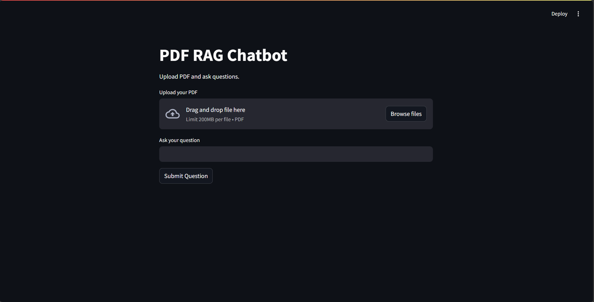
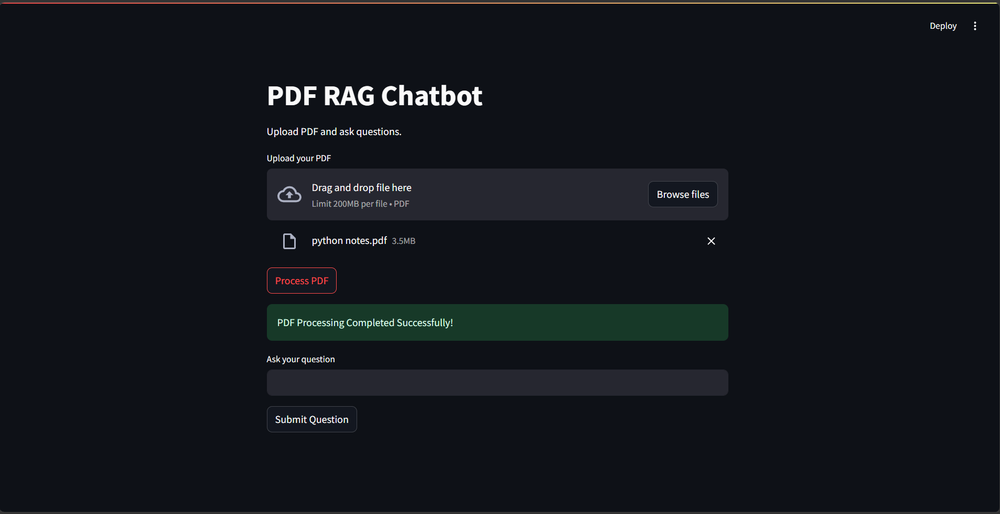
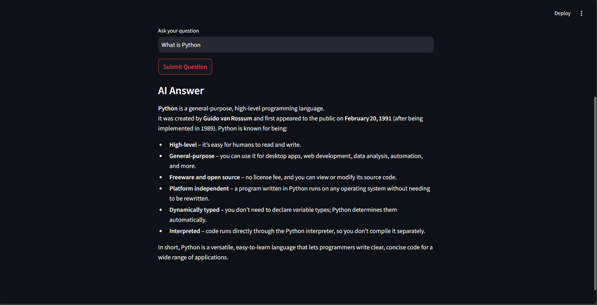

# 📚 AI-Powered PDF Question Answering Chatbot

An AI-powered PDF Question Answering Chatbot built using **Retrieval-Augmented Generation (RAG), LangChain, ChromaDB, Groq LLM, and Streamlit**.

This application allows users to upload PDF documents and ask questions about their content. It retrieves relevant information from the uploaded PDF and uses a Large Language Model (LLM) to generate context-based answers.

---

## 🚀 Project Overview

Reading and searching through large PDF documents can be time-consuming.

To solve this problem, I developed an AI-powered PDF chatbot that allows users to interact with their PDF documents through natural language questions.

The application follows the RAG architecture to retrieve relevant document information and generate answers using an LLM.

## ✨ Features

- 📄 Upload PDF documents.
- 🔍 Extract text from PDF files.
- ✂️ Split large documents into smaller chunks.
- 🧠 Generate vector embeddings.
- 🗄️ Store document embeddings in ChromaDB.
- 🔎 Retrieve relevant document chunks using similarity search.
- 🤖 Generate AI-powered answers using Groq LLM.
- 💬 Ask questions in natural language.
- 🖥️ Interactive user interface using Streamlit.

## 🛠️ Technologies Used

| Technology | Purpose |
|---|---|
| Python | Backend programming |
| Streamlit | Web application interface |
| LangChain | RAG pipeline and LLM integration |
| ChromaDB | Vector database |
| PyPDF | PDF text extraction |
| Default Chroma Embeddings | Text vectorization |
| Groq API | LLM integration |
| GPT-OSS 20B | AI answer generation |

## 🏗️ Project Architecture

The application follows a Retrieval-Augmented Generation (RAG) architecture.

```text
             PDF Upload
                  |
                  v
              PDF Loader
                  |
                  v
             Text Extraction
                  |
                  v
              Text Splitting
                  |
                  v
             Embeddings
                  |
                  v
               ChromaDB
                  |
                  |
            User Question
                  |
                  v
           Similarity Search
                  |
                  v
         Relevant Document Chunks
                  |
                  v
          Context + User Question
                  |
                  v
               Groq API
                  |
                  v
              GPT-OSS 20B
                  |
                  v
          AI Generated Answer
                  |
                  v
              Streamlit UI
```

## 📂 Project Structure

```text
AI-Powered-PDF-RAG-Chatbot/
│
├── data/
│   └── PDF documents
│
├── vectordb/
│   └── ChromaDB storage (generated automatically)
│
├── app.py
├── ingest.py
├── query.py
├── requirements.txt
├── .env
├── .gitignore
└── README.md
```

## ⚙️ Installation and Setup

### 1. Clone the Repository

```bash
git clone https://github.com/ADII877/AI-Powered-PDF-RAG-Chatbot.git
```

### 2. Navigate to the Project Directory

```bash
cd AI-Powered-PDF-RAG-Chatbot
```

### 3. Create a Virtual Environment

```bash
python -m venv .venv
```

### 4. Activate the Virtual Environment

For Windows:

```bash
.venv\Scripts\activate
```

### 5. Install Required Dependencies

```bash
pip install -r requirements.txt
```

### 6. Configure Groq API Key

Create a `.env` file in the project root directory.

Add your Groq API key:

```env
GROQ_API_KEY=your_groq_api_key
```

Get your API key from:

https://console.groq.com/

**Note:** Never upload your `.env` file or expose your API key on GitHub.

### 7. Run the Application

Execute the following command:

```bash
streamlit run app.py
```

The application will open in your default web browser.

## 💡 How to Use

1. Start the Streamlit application.
2. Upload a PDF document.
3. Click the **Process PDF** button.
4. Wait for the document processing to complete.
5. Enter your question in the question input field.
6. Click **Submit Question**.
7. The chatbot retrieves relevant information from ChromaDB.
8. Groq LLM generates an answer using the retrieved context.
9. View the AI-generated answer in the application.

## 🧠 How RAG Works in This Project

**Retrieval-Augmented Generation (RAG)** combines information retrieval with Large Language Models.

This project follows three main stages:

**1. Retrieval**

The user's question is converted into an embedding and compared with stored document embeddings in ChromaDB to retrieve relevant text chunks.

**2. Augmentation**

The retrieved document chunks are added to the prompt as context along with the user's question.

**3. Generation**

The Groq-hosted GPT-OSS 20B model uses the provided context to generate a natural-language answer.

## 📸 Application Screenshots

### 1. Chatbot Interface



### 2. PDF Upload



### 3. AI Generated Answer



## 🔮 Future Enhancements

- Support for multiple PDF documents.
- Conversational memory.
- Chat history management.
- PDF source page references.
- Streaming AI responses.
- Improved document retrieval.
- Deployment using Streamlit Community Cloud.

## 👨‍💻 Author

**Aditya Sadekar**

GitHub: https://github.com/ADII877

LinkedIn: Add your LinkedIn profile URL.

---

⭐ If you find this project interesting, consider giving it a star!

**Built with Python, RAG, LangChain, ChromaDB and Groq LLM.**